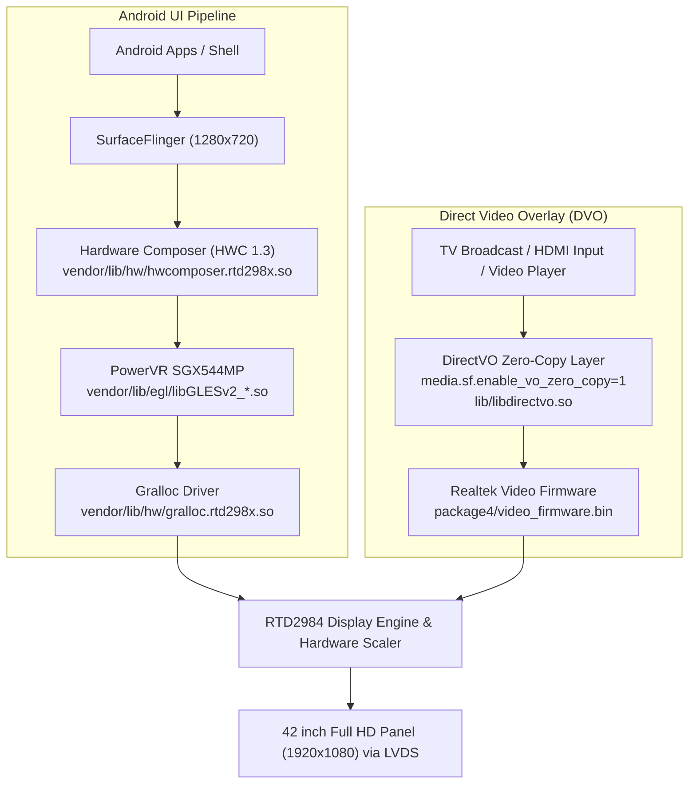

# PhilcoOS — Hardware Dependencies Report

**Device:** Philco PH42F10DSGW (Smart TV)  
**Platform:** Realtek RTD2984TD-GR (`rtd298x`)  
**Board:** CVTE TP.RT2984T.PB801  
**Date of Analysis:** 2026-11-20  

---

## 1. Graphics & Display Pipeline

The display system operates in a hybrid rendering mode: Android UI surfaces are rendered by the GPU via SurfaceFlinger, while live TV and hardware video playback bypass the Android graphics pipeline via Realtek Direct Video Overlay (DVO).



### Essential Graphics Dependencies:
* **EGL / GLES Libraries (`/system/vendor/lib/egl/`):**
  * `libEGL_POWERVR_SGX544_115.so`
  * `libGLESv1_CM_POWERVR_SGX544_115.so`
  * `libGLESv2_POWERVR_SGX544_115.so`
* **GPU Core Driver Libraries (`/system/vendor/lib/`):**
  * `libIMGegl.so`, `libPVRScopeServices.so`, `libglslcompiler.so`, `libpvr2d.so`, `libpvrANDROID_WSEGL.so`, `libsrv_init.so`, `libsrv_um.so`, `libusc.so`
* **Hardware Abstraction Layer (HAL):**
  * `vendor/lib/hw/gralloc.rtd298x.so`
  * `vendor/lib/hw/hwcomposer.rtd298x.so`
  * `vendor/lib/hw/memtrack.rtd298x.so`
* **Direct Video Overlay (DVO):**
  * `/system/lib/libdirectvo.so`
  * Kernel carveouts: `reclaim=72M@32M last_image=8M@160M`

---

## 2. Audio Subsystem Architecture

Audio processing is offloaded to a dedicated Realtek Audio DSP coprocessor running independent microcode (`bluecore.audio`).

### Key Audio Components & Dependencies:
* **Audio Microcode & Bootstrap:**
  * `package4/bluecore.audio` (1,916,960 bytes)
  * `package4/bootfile.audio` (40,750 bytes)
* **Audio HAL & Android Libraries:**
  * `/system/lib/hw/audio.primary.rtd298x.so`
  * `/system/lib/libOMX.RTK.audio.decoder.so`
  * `/system/lib/libOMX.RTK.audio.osal.so`
  * `/system/lib/librtka2dp.so` (Bluetooth audio bridge)
* **Configuration Files:**
  * `/system/etc/audio_policy.conf`
  * `/system/etc/audio_effects.conf`
  * `/system/etc/permissions/android.hardware.audio.low_latency.xml`

---

## 3. Video Decoding & Processing Architecture

Video decoding and hardware scaling are performed in hardware through the Realtek Video Processing Unit (VPU).

### Essential Video Dependencies:
* **VPU Microcode & Bootstrap:**
  * `package4/video_firmware.bin` (3,545,576 bytes)
  * `package4/bootfile.image` (94,204 bytes)
* **OpenMAX Video Codecs:**
  * `/system/lib/libOMX.RTK.video.decoder.so`
  * `/system/lib/libOMX.RTK.video.encoder.so`
* **Media Configurations:**
  * `/system/etc/media_profiles.xml`
  * `/system/etc/media_codecs.xml`

---

## 4. TV Tuner, Broadcast & Middleware (ISDB-T / Ginga)

Unlike standard Android mobile devices, TV functionality on the RTD298x is orchestrated by an autonomous background daemon stack running in `/system/rtk_rootfs/`.

### Architecture of the TV Stack:
1. **Daemon Supervisor:** `/system/rtk_rootfs/usr/local/bin/RootApp`
2. **Main TV Server:** `/system/rtk_rootfs/usr/local/bin/TvServer` (33.3 MB monolithic binary)
   * Direct control of Silicon Tuner and ISDB-Tb/ATV Demodulator
   * Audio/Video input channel multiplexer
   * HDMI input detection and HDCP key verification
   * Transport Stream (TS) demuxing and decoding
3. **Brazilian DTV Interactive Middleware (Ginga / JavaTV):**
   * `/system/rtk_rootfs/usr/local/bin/EITV/jar/javatv.jar` (EITV Ginga stack)
   * `/system/rtk_rootfs/usr/local/bin/gingaEnv.sh`
   * DirectFB backend: `/system/rtk_rootfs/usr/local/bin/solib/libdirectfb-1.4.so.0.2.0`
4. **Android TV Application & IPC Layer:**
   * `/system/app/TSB_Tv.apk` (User-facing TV channel viewer, channel scan, EPG)
   * `/system/app/SourceMenu.apk` (Source switcher UI: HDMI 1/2/3, AV, Component, TV)
   * `/system/lib/librpccore.so` (Realtek Remote Procedure Call client)
   * `/system/lib/libRtkFramework.so` (Android framework bindings to TvServer)
   * `/system/lib/libcvtedatacontrol.so` (CVTE channel and picture data manager)
   * Startup scripts: `/system/etc/init.tvserver.sh` and `/system/etc/init.tvserver.cvte.sh`

---

## 5. Wi-Fi & Network Architecture

### Active Wireless Adapter:
* **Chipset:** MediaTek **MT7601U** USB 802.11b/g/n Wi-Fi adapter
* **Kernel Module:** `/system/rtk_rootfs/lib/modules/3.7.2-298x/kernel/drivers/net/wireless/rtlwifi/rtlmt7601Usta/mt7601Usta.ko` (1,954,788 bytes)
* **Runtime Verification:** Detected active in `dmesg`:
  ```text
  <4>[ 7583.102321] 2[MT7601_get_rssi]:StaCount=0,Avg Rssi=-66,pAd->OpMode=0
  ```

### Fallback Driver Modules (Board Revisions):
* Realtek 8188EU (`8188eu.ko`)
* Realtek 8188FU (`8188fu.ko`)
* Realtek 8192CU (`8192cu.ko`)
* Realtek 8192DU (`8192du.ko`)
* Realtek 8192EU (`8192eu.ko`)
* Realtek 8812AU (`8812au.ko`)
* Network configuration: `wifi.interface=wlan0`, `wifi.supplicant_scan_interval=15`

---

## 6. Remote Control & Input Peripherals

* **IR Daemon:** Remote control decoding is initialized at boot via `/bin/setir -p 1`.
* **Hardware Key Service:** `/system/app/com.cvte.keyservice.apk`
  * Translates hardware IR scancodes into Android `KeyEvent` actions (Power, Volume, Channel, Source, Menu, Directional pad, Numeric keys).
  * Manages physical tactile front-panel buttons on the TV chassis.
* **Touch / Mouse Support:** Standard Android `InputReader` / `InputDispatcher` supporting USB wireless air mice and keyboards.

---

## 7. Hardware Dependencies Summary Matrix

| Subsystem | Microcode / Kernel Driver | Native Userspace Daemon / HAL | Android Userland Interface | Can Be Removed? |
| :--- | :--- | :--- | :--- | :--- |
| **GPU (PowerVR)** | Kernel PVR services | `vendor/lib/egl/*`, `gralloc.rtd298x.so`, `hwcomposer.rtd298x.so` | SurfaceFlinger | **NO (Critical)** |
| **Video VPU** | `package4/video_firmware.bin` | `libOMX.RTK.video.decoder.so`, `libdirectvo.so` | Stagefright / DVO | **NO (Critical)** |
| **Audio DSP** | `package4/bluecore.audio` | `audio.primary.rtd298x.so`, `libOMX.RTK.audio.decoder.so` | AudioFlinger | **NO (Critical)** |
| **TV Tuner / HDMI** | Kernel I2C/Demux | `/system/rtk_rootfs/usr/local/bin/TvServer`, `librpccore.so` | `TSB_Tv.apk`, `SourceMenu.apk` | **NO (Critical)** |
| **IR Remote / Keys** | Kernel IR driver (`setir`) | Kernel event device | `com.cvte.keyservice.apk` | **NO (Critical)** |
| **Wi-Fi** | `mt7601Usta.ko` | `wpa_supplicant` | Settings / ConnectivityService | **NO (Critical)** |
| **Stock Launcher** | None | Standard Android Activity | `LancherProject2995.apk` | **YES (Replace with Lean Launcher)** |
| **Aptoide App Store** | None | None | `priv-app/aptoide.apk` | **YES (Safe to delete)** |
| **QiJi Browser** | None | None | `priv-app/QjyBrowser.apk` | **YES (Safe to delete)** |
| **SelfTest Tool** | None | None | `app/SelfTest.apk` | **YES (Safe to delete)** |
