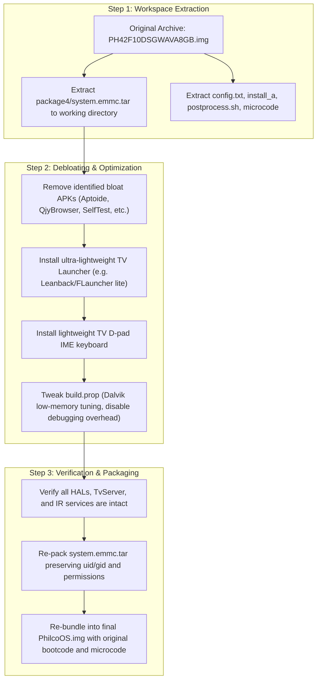

# PhilcoOS — Custom ROM Build Strategy

**Device:** Philco PH42F10DSGW (Smart TV)  
**Target:** ONE Final, Lightweight Custom ROM with 100% Original TV Functionality  
**Platform:** Realtek RTD2984TD-GR (`rtd298x`)  
**Base OS:** Android 4.4.2 KitKat (API 19)  
**Date:** 2026-11-20  

---

## 1. Executive Summary & Core Directives

The goal of the PhilcoOS project is to produce a streamlined, rock-solid custom ROM for the Philco PH42F10DSGW TV.
The original firmware is heavily constrained by **512 MB physical RAM** (only ~446 MB visible to the kernel after hardware carveouts) and suffers from sluggish performance, high boot latency, and out-of-memory app killing caused by obsolete bloatware (Aptoide store, QiJi browser, 24MB vendor launcher, dead OTA services, Chinese testing tools).

### Governing Constraints:
1. **Zero Modifications to Kernel & Bootloader:** The Linux kernel (`vmlinux.develop.*`), bootcode (`bootloader.tar`), rescue system (`0.vmlinux.rescue.bin`), and hardware microcode (`bluecore.audio`, `video_firmware.bin`) must remain 100% bit-for-bit identical to the factory image.
2. **Preserve All TV Hardware Functionality:** ISDB-Tb Digital TV tuning, Analog TV, HDMI 1/2/3 switching, AV inputs, IR remote control decoding, physical buttons, panel picture settings, and audio decoding must operate without regressions.
3. **Reproducible & Reversible:** Standard archive-based build pipeline without proprietary packaging tools.

---

## 2. Component Retention & Removal Matrix

### 2.1 Essential Components (MUST PRESERVE)

| Component | Path / Package | Function | Why It Must Be Preserved |
| :--- | :--- | :--- | :--- |
| **TV Backend Server** | `/system/rtk_rootfs/usr/local/bin/TvServer` | Hardware TV daemon | Directly drives silicon tuner, demodulator, HDMI switch, and TS demuxer. |
| **Server Supervisor** | `/system/rtk_rootfs/usr/local/bin/RootApp` | Process manager | Keeps `TvServer` alive and supervises crash recovery. |
| **DTV/ATV UI** | `/system/app/TSB_Tv.apk` | TV user interface | User interface for channel scanning, program guide (EPG), and TV watching. |
| **Source Menu** | `/system/app/SourceMenu.apk` | Input switcher | Allows selecting HDMI 1, HDMI 2, HDMI 3, AV, and TV tuner inputs. |
| **IR Remote Service** | `/system/app/com.cvte.keyservice.apk` | Input listener | Bridges physical IR remote signals and chassis buttons to Android key events. |
| **TV Settings** | `/system/priv-app/RTKSettings.apk` | TV configuration | Controls screen aspect ratio, audio modes, channel tuning, and network. |
| **Factory / Engineer Menu** | `/system/priv-app/RTK_engineer_menu.apk` | Panel calibration | Critical for white balance, LVDS mapping, and panel service parameters. |
| **USB Media Browser** | `/system/app/MediaBrowser.apk` | Media player | Local playback of video/audio/photo files from USB drives via hardware VPU. |
| **Screen Mirroring** | `/system/app/RTKMiracast.apk` | Miracast sink | Wireless display receiver for mobile phones and laptops. |
| **Graphics & HALs** | `/system/vendor/lib/*`, `/system/lib/hw/*` | Hardware drivers | PowerVR SGX544 GPU drivers, Gralloc, HWComposer 1.3, Audio HAL. |
| **Hardware Codecs** | `/system/lib/libOMX.RTK.*`, `libdirectvo.so` | Media pipeline | Realtek hardware-accelerated OpenMAX audio/video decoders and DVO overlay. |
| **RPC / IPC Layer** | `/system/lib/librpccore.so`, `libRtkFramework.so` | Client-server IPC | Enables Android apps to send commands to `TvServer`. |
| **Wireless Drivers** | `/system/rtk_rootfs/lib/modules/.../*.ko` | Network drivers | MediaTek MT7601U driver (`mt7601Usta.ko`) and Realtek fallback Wi-Fi modules. |
| **Ginga Middleware** | `/system/rtk_rootfs/usr/local/bin/EITV/` | Interactive TV | Required for Brazilian DTV interactive broadcast compliance. |

---

### 2.2 Removal Candidates (BLOAT & RAM RECLAIM)

Removing these packages frees approximately **75+ MB of storage** and saves over **80+ MB of precious active runtime RAM**:

| Component | Path / Package | Size | Reason for Removal |
| :--- | :--- | :--- | :--- |
| **Vendor Launcher** | `/system/app/LancherProject2995.apk` | 23.65 MB | Bloated, sluggish CVTE TV launcher. Replace with lightweight TV launcher (< 2 MB). |
| **Obsolete Browser** | `/system/priv-app/QjyBrowser.apk` | 19.09 MB | Outdated, unmaintained Chinese browser; security hazard and RAM drain. |
| **Obsolete Store** | `/system/priv-app/aptoide.apk` | 13.68 MB | Bundled 3rd-party store that fails to update and spawns background telemetry. |
| **Heavy AOSP Keyboard** | `/system/app/LatinIME.apk` | 11.85 MB | Full AOSP mobile keyboard with heavy dictionaries. Replace with lean D-pad TV keyboard (< 1.5 MB). |
| **Factory QA Tool** | `/system/app/SelfTest.apk` | 6.95 MB | Assembly line hardware test tool; never used by end consumers. |
| **Dead OTA Updater** | `/system/priv-app/OTAupdate.apk` | 1.66 MB | Hardcoded to nonexistent CVTE/Philco update servers; drains CPU on failure retries. |
| **Fake Cleaner App** | `/system/priv-app/OneClickCleaner.apk` | 0.04 MB | Useless RAM cleaner bloatware that kills background services prematurely. |
| **Telephony Services** | `/system/priv-app/TeleService.apk` | 0.75 MB | Mobile phone telephony stack (GSM/CDMA); completely useless on a TV. |
| **Telephony Provider** | `/system/app/TelephonyProvider.apk` | 0.08 MB | Telephony database provider for SMS and SIM calls. |
| **WAP Push Manager** | `/system/app/WAPPushManager.apk` | 0.01 MB | Mobile cellular messaging service. |
| **Calendar Sync & Provider** | `CalendarProvider.apk`, `calendarSync.apk` | 0.36 MB | Mobile calendar database and sync adapters; never used on a TV. |
| **Contacts Provider** | `/system/priv-app/ContactsProvider.apk` | 0.30 MB | Mobile address book service. |
| **Live Wallpapers** | `Galaxy4.apk`, `LiveWallpapersPicker.apk`, `NoiseField.apk`, `PhotoTable.apk`, `BasicDreams.apk` | 0.92 MB | GPU and RAM hogs that degrade UI responsiveness on low-memory hardware. |
| **Unused Voice Libs** | `/system/lib/libwechatvoicereco.so`, `libwechatvoicesilk*.so` | 1.03 MB | WeChat proprietary voice codecs bundled from Chinese base ROM. |

---

## 3. Step-by-Step Custom ROM Build Strategy (Future Phase)

### Phase-by-Phase Plan:

1. **Extraction (Safe Staging):**
   * Unpack `package4/system.emmc.tar` into a staging directory inside `extracted/`.
   * Preserve all file timestamps, permissions, symlinks, and directory hierarchies.
2. **System Debloating:**
   * Purge the 14 identified bloat packages.
   * Introduce a streamlined, open-source TV launcher designed for directional pad (D-pad) navigation, consuming < 25 MB RAM (saving ~60 MB compared to `LancherProject2995.apk`).
   * Introduce a clean D-pad compatible on-screen keyboard.
3. **Runtime & Dalvik Heap Tuning (`build.prop`):**
   * Ensure `ro.config.low_ram=true` is maintained.
   * Tune `dalvik.vm.heapgrowthlimit=36m` or `48m` to prevent background tasks from hoarding heap.
   * Disable unnecessary logging and debugging props (`persist.sys.strictmode.disable=1`, `dalvik.vm.checkjni=false`).
4. **Preserve Permissions & Repackaging:**
   * Pack modified `/system` tree back into `package4/system.emmc.tar` using standard POSIX TAR format.
   * Retain original `postprocess.sh` to ensure `install_a` applies correct POSIX permissions on `/data` and `/system`.
   * Recreate the outer `.img` archive with `config.txt`, `0.vmlinux.rescue.bin`, `install_a`, `customer`, `font.ttf`, `mm`, `otares.tar.bz2`, `postprocess.sh`, and `package4/`.

---

## 4. Safety & Reversibility Protocol

* **Bit-Identical Boot & Microcode:** Never recompile or touch `bootloader.tar`, `vmlinux.develop.*`, `bluecore.audio`, or `video_firmware.bin`.
* **Preserve Factory Panel Config:** Never modify `package4/factory.tar` (`vip_default.bin`, `panel.bin`). Doing so could overdrive panel LVDS signals or cause display inversion.
* **Master Backup:** Keep `C:\PhilcoOS\original\PH42F10DSGWAVA8GB.img` write-protected as the golden recovery image.
