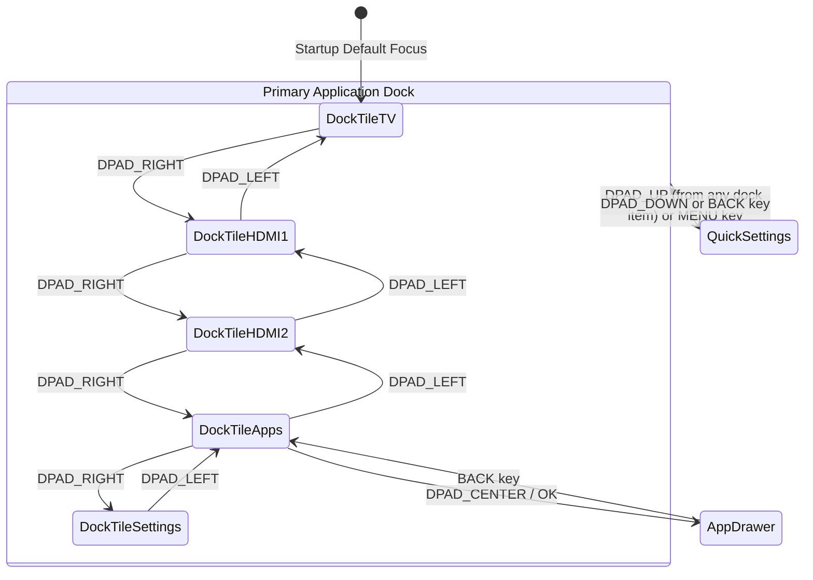

# PhilcoOS Ultra 777 — Engineering & System Architecture Specification

**Component:** PhilcoOS Ultra 777 Home (`philco-home`)  
**Package Identifier:** `com.philco.ultra777.home`  
**Target Platform:** Android 4.4.2 KitKat (API Level 19)  
**Hardware Target:** Realtek RTD2984TD-GR (`rtd298x`) / CVTE TP.RT2984T.PB801 / 512 MB DDR3  
**Document:** `C:\PhilcoOS\docs\PHILCOOS_ULTRA_777_ARCHITECTURE.md`  
**Date:** 2026-11-20  
**Status:** Approved Architectural Specification  

---

## 1. Architectural Philosophy & Technology Selection

The architecture is governed by the strict physical constraints of the television:
- **512 MB Physical RAM:** Kernel and hardware carveouts reduce visible memory to ~446 MB. The stock launcher (`LancherProject2995.apk`) hoarded 23.65 MB of storage and >50 MB of Dalvik heap. PhilcoOS Ultra 777 is engineered to operate within **< 12 MB Dalvik PSS**.
- **No Heavy Frameworks:** Strictly built on pure native Android SDK (Java 7/8 bytecode targeting Android API 19). Zero dependencies on Flutter, React Native, WebView, Chromium, or Jetpack Compose.
- **Zero Persistent Background Services:** Operates entirely as a standard foreground Activity that releases or unregisters broadcast receivers during lifecycle pauses.

```
+----------------------------------------------------------------------------------------------------+
|                                    PhilcoOS Ultra 777 Architecture                                 |
+----------------------------------------------------------------------------------------------------+
|                                      MainActivity (HOME / DEFAULT)                                 |
|                                                                                                    |
|  +-----------------------+  +-----------------------+  +-----------------------+                   |
|  |   TopBarController    |  |     DockController    |  |  QuickSettingsPanel   |                   |
|  | - Date/Clock Receiver |  | - 5 Primary Shortcuts |  | - Real Volume Slider  |                   |
|  | - Network Telemetry   |  | - Focus Scale/Halo    |  | - Wi-Fi/Source Links  |                   |
|  +-----------------------+  +-----------------------+  +-----------------------+                   |
|                                         |                                                          |
|                             +-----------------------+                                              |
|                             |   AppDrawerManager    |                                              |
|                             | - Async PackageManager|                                              |
|                             | - 5x3 Grid D-Pad Nav  |                                              |
|                             +-----------------------+                                              |
|                                         |                                                          |
|  +-----------------------------------------------------------------------------------------------+ |
|  |                              OEMHardwareIntegrationBridge                                     | |
|  |  * Live TV:        com.tsb.tv / .Tv_strategy (ISDB-Tb Hardware Demux)                         | |
|  |  * Input Switch:   com.hikeen.xymenu / .MainActivity (HDMI 1, HDMI 2, AV)                     | |
|  |  * TV Settings:    com.android.settings / .Settings (Display/Audio/Tuner)                      | |
|  |  * Media Browser:  com.rtk.mediabrowser / .MediaBrowser (Hardware VPU Local Playback)         | |
|  +-----------------------------------------------------------------------------------------------+ |
+----------------------------------------------------------------------------------------------------+
```

---

## 2. Package & Directory Structure

Project Root: `C:\PhilcoOS\source\philco-home\`

```text
philco-home/
├── AndroidManifest.xml                  # Manifest with HOME, DEFAULT, and TV leanback banners
├── build.gradle                         # Standard Gradle build script targeting API 19
├── src/
│   └── com/philco/ultra777/home/
│       ├── MainActivity.java            # Master Home Activity orchestrating UI and D-Pad focus
│       ├── FocusAnimationHelper.java    # Zero-overhead scale and elevation animations (API 19)
│       ├── OEMIntegrationHelper.java    # Verified manufacturer intent bridges (TV, HDMI, Settings)
│       ├── SystemTelemetryReceiver.java # Broadcast listener for TIME_TICK, Connectivity changes
│       ├── AppDrawerAdapter.java        # Grid adapter for all installed applications
│       ├── AppItem.java                 # Model entity for discovered launchable applications
│       ├── DockItem.java                # Model entity for main dock shortcuts
│       └── QuickSettingsController.java # Quick settings modal sheet controller
└── res/
    ├── drawable/                        # Pure XML frosted glass cards, gradients, and icons
    │   ├── bg_wallpaper_cinematic.xml   # Deep navy and atmospheric twilight gradient
    │   ├── bg_glass_dock.xml            # Glassmorphic dock pill
    │   ├── bg_glass_tile_normal.xml     # Default dock tile surface
    │   ├── bg_glass_tile_focused.xml    # Focused dock tile with cyan rim and highlight
    │   ├── ic_tv.xml                    # Vector-like Live TV icon
    │   ├── ic_hdmi.xml                  # Vector-like HDMI icon
    │   ├── ic_apps.xml                  # App drawer icon
    │   ├── ic_settings.xml              # TV Settings gear icon
    │   ├── ic_wifi.xml                  # Wi-Fi indicator icon
    │   └── ic_eth.xml                   # Ethernet indicator icon
    ├── layout/
    │   ├── activity_main.xml            # 1280x720 master stage layout
    │   ├── item_dock_tile.xml           # Individual dock tile layout
    │   ├── item_app_grid.xml            # Grid item for application library
    │   └── panel_quick_settings.xml     # Slide-out quick settings overlay
    ├── values/
    │   ├── colors.xml                   # Palette (Midnight Navy, Cyan Glow, Glass White)
    │   ├── dimens.xml                   # Sizing and 10-foot viewing spacing (1280x720 baseline)
    │   ├── strings.xml                  # English default strings
    │   └── styles.xml                   # Leanback and NoTitleBar full-screen themes
    └── values-pt/
        └── strings.xml                  # Brazilian Portuguese localization
```

---

## 3. Verified OEM Subsystem Integration Matrix

Based on direct DEX and Manifest inspection of original factory APKs in `C:\PhilcoOS\extracted\factory_baseline\system`:

| Logical Shortcut | Target Package | Target Component / Action | Verification Status | Evidential Source |
| :--- | :--- | :--- | :--- | :--- |
| **Live TV (ISDB-Tb)** | `com.tsb.tv` | `com.tsb.tv.Tv_strategy` | `[CONFIRMED]` | `TSB_Tv.apk` Manifest (`ACTION_MAIN` / `CATEGORY_LAUNCHER`) |
| **HDMI 1 / Input Switch** | `com.hikeen.xymenu` | `com.hikeen.xymenu.MainActivity` | `[CONFIRMED]` | `SourceMenu.apk` Manifest & DEX constants (`SOURCE_HDMI1`) |
| **HDMI 2 / Input Switch** | `com.hikeen.xymenu` | `com.hikeen.xymenu.MainActivity` | `[CONFIRMED]` | `SourceMenu.apk` Manifest & DEX constants (`SOURCE_HDMI2`) |
| **TV System Settings** | `com.android.settings`| `com.android.settings.Settings` | `[CONFIRMED]` | `RTKSettings.apk` Manifest (`ACTION_MAIN`) |
| **USB Media Browser** | `com.rtk.mediabrowser` | `com.rtk.mediabrowser.MediaBrowser` | `[CONFIRMED]` | `MediaBrowser.apk` Manifest (`ACTION_MAIN` / `CATEGORY_LAUNCHER`) |
| **Wi-Fi Settings Direct**| `com.android.settings`| `com.android.settings.wifi.WifiSettings`| `[CONFIRMED]` | `RTKSettings.apk` Sub-Activity |
| **Screen Mirroring** | `com.rtk.android.miracast`| `com.rtk.android.miracast.MiracastActivity`| `[CONFIRMED]` | `RTKMiracast.apk` Manifest |

---

## 4. D-Pad Focus Management & State Machine

Remote control input is intercepted cleanly through standard Android View focus callbacks (`OnFocusChangeListener`) and `dispatchKeyEvent`:



---

## 5. Memory & Lifecycle Optimization Rules

1. **Static Drawable Shading:** No runtime RenderScript blur kernels. All frosted glass effects are rendered via pre-compiled XML drawables utilizing 32-bit ARGB surfaces with hardware acceleration enabled (`android:hardwareAccelerated="true"`).
2. **Asynchronous Package Querying:** `PackageManager.queryIntentActivities()` executes inside a single background `AsyncTask`, populating the grid smoothly without stalling the main UI thread during boot.
3. **Event-Driven UI Updates:** The clock and date are updated strictly via a registered `BroadcastReceiver` listening for `Intent.ACTION_TIME_TICK`, `ACTION_TIME_CHANGED`, and `ACTION_TIMEZONE_CHANGED`. **Zero polling loops or timers run in the background.**
4. **Lifecycle Resource Cleanup:** When an external application (e.g. `TSB_Tv` or YouTube) is launched, `MainActivity.onStop()` unregisters broadcast receivers and dismisses dialog overlays, allowing the Android Low Memory Killer (LMK) to reclaim execution memory if needed.
